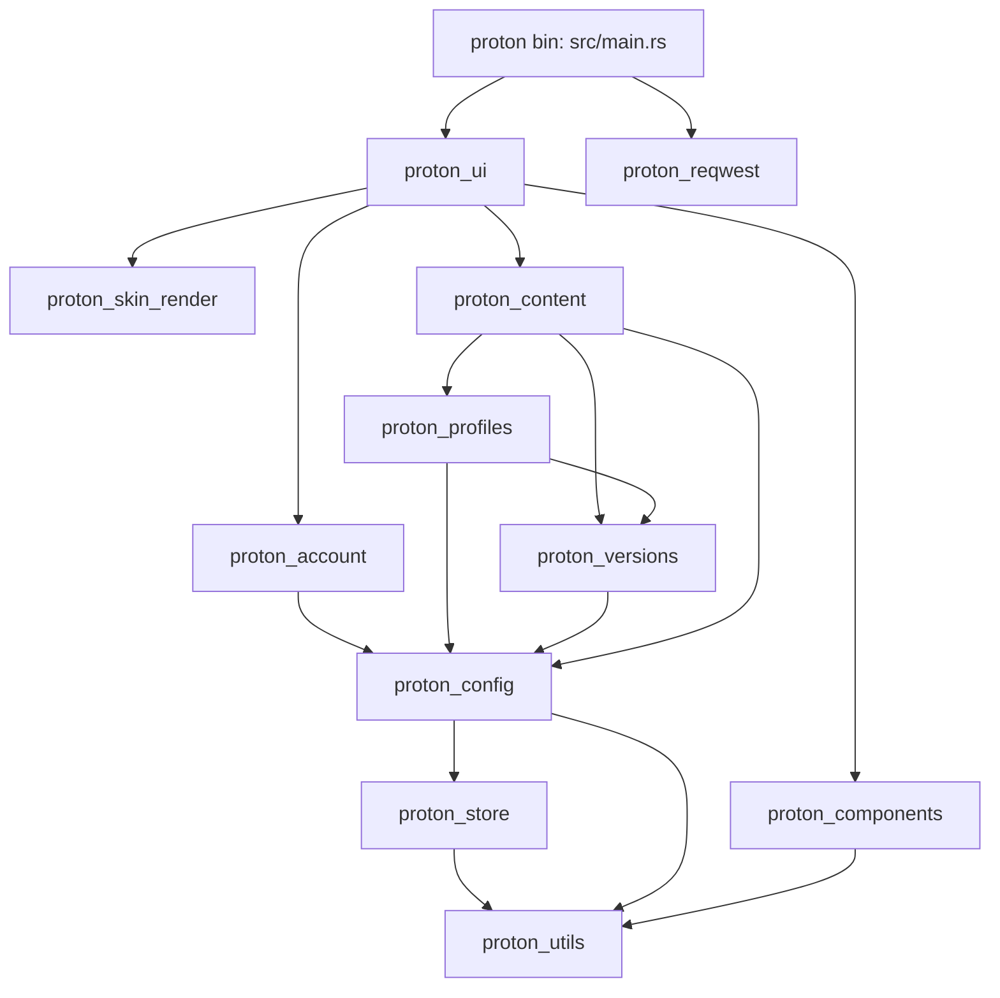

# Proton architecture

Proton is a Minecraft launcher: Microsoft accounts, profiles (vanilla, Fabric, Quilt, Forge,
NeoForge), Java and game downloads, mods/resource packs/shaders/modpacks from Modrinth and
CurseForge, live game consoles, skins and capes. It is a native Rust app built on
[gpui](https://www.gpui.rs/) through `gpui-kit` 0.7.3 (shadcn-style components). It replaced a
Tauri + SvelteKit app and keeps that app's data on disk, its bundle identifier and its update
channel.

Stack: Rust 2024, cargo workspace (`crates/*` plus the root `proton` bin), gpui-kit, tokio
(network, fs, processes), reqwest, flume channels, wgpu (skin renderer), cargo-packager
(bundles + self update), nix/devenv for the toolchain.

## Crate map

| Crate (`crates/`)                    | Purpose                                                                 | Key modules / types                                                                                                                                                            | Depends on (proton\_\*)                  |
| ------------------------------------ | ----------------------------------------------------------------------- | ------------------------------------------------------------------------------------------------------------------------------------------------------------------------------ | ---------------------------------------- |
| `utils` (`proton_utils`)             | Shared helpers, no gpui state                                           | `dir` (app dirs, `IDENTIFIER`), `rt` (tokio runtime), `entity::WriteChangedExt`, `log` (`init`, `ErrorLogExt`), `logs::LogBuffer`, `download`, `file`, `future::UpdateLimiter` | -                                        |
| `store` (`proton_store`)             | `store.json` key-value store, same file/format as tauri-plugin-store    | `store()`, `init_at`, `Store::{get_or_default, set, delete}`                                                                                                                   | utils                                    |
| `reqwest` (`proton_reqwest`)         | gpui's HTTP client (images etc.) with an on-disk HTTP cache             | `client()`, `CachedHttpClient`, `policy`, `cleanup`                                                                                                                            | -                                        |
| `config` (`proton_config`)           | Settings + online/offline state                                         | `SettingsState`/`SettingsExt`, `update`, `settings::Settings`, `Offline`/`OfflineExt`, `offline::OfflineHandle`                                                                | utils, store                             |
| `versions` (`proton_versions`)       | Manifests, Java/MC/loader downloads, game launch, downloads panel model | `Versions`/`VersionsExt`, `download/*`, `loader/*`, `launch`, `event::DownloadsHandle`, `downloads::DownloadProgress`, `store::McVersionStore`                                 | utils, config                            |
| `account` (`proton_account`)         | Microsoft login, accounts, skins and capes                              | `Accounts`/`AccountsExt`, `auth`, `mc_auth`, `info`, `store`, `skin_store`, `AccountsHandle`                                                                                   | utils, store, config                     |
| `profiles` (`proton_profiles`)       | Profiles, running instances, logs, quick play, file watcher             | `Profiles`/`ProfilesExt`, `ProfilesHandle`, `config::Profile`, `instance`, `store::ProfileStore`, `watcher`, `server`                                                          | utils, store, config, versions           |
| `content` (`proton_content`)         | Modrinth/CurseForge search, install, modpacks, update checks            | `Content`/`ContentExt`, `service`, `provider`, `modrinth`, `curseforge`, `install`, `modpack`, `updates`, `store::Manifest`, `render`                                          | utils, store, config, versions, profiles |
| `components` (`proton_components`)   | Theme, assets, fonts, shared widgets, test helpers                      | `assets` (`THEME`, `LINE_HEIGHT`, `open_window`, `load`), `widgets/*`, `render_count`, `test_view`                                                                             | utils                                    |
| `skin_render` (`proton_skin_render`) | Offscreen wgpu player model renderer + gpui views                       | `Renderer`, `SkinViewer`, `MiniSkinViewer`, `SkinTextures`                                                                                                                     | -                                        |
| `ui` (`proton_ui`)                   | Shell, router, pages, startup glue, updater                             | `app`, `shell`, `router`, `pages/*`, `content` (dialogs), `actions`, `updater`                                                                                                 | all of the above                         |
| root `proton` (`src/main.rs`)        | Binary: init order, single instance                                     | `main`                                                                                                                                                                         | ui + every service                       |

Layering rule: services (`config`, `versions`, `account`, `profiles`, `content`) never depend on
`ui` or `components`. `ui` is the only crate that knows about pages and routes.

## Startup sequence

`src/main.rs`:

1. `proton_utils::dir::migrate()` moves the old `de.proton.mc` data dir, then `log::init()`
   (stdout + one file per run in `dir::log_dir()`).
2. Single instance: `app::single_instance::acquire` on `$XDG_RUNTIME_DIR/io.profidev.proton.sock`
   (named pipe on Windows). A second launch asks the first to focus and exits. After an update
   restart (`updater::RESTART_ENV`) it retries for up to 5s while the old process lets go.
3. `gpui_kit::application()` with `components::assets::Assets` and `proton_reqwest::client()`.
4. Inside `run`: `gpui_kit::init`, `assets::load` (fonts, themes, mono font), then the services
   in dependency order: `config` → `versions` → `account` → `profiles` → `content` (profiles
   and manifests load on tokio, `Profiles::loaded` flips when the profiles are in), then
   `proton_ui::init` (router, shell data, updater globals) and `pages::register_all`.
5. `proton_ui::app::start` (`crates/ui/src/app.rs`):
   - `restore_route`: `settings.url` (old SvelteKit URLs parse too),
     else Home. `persist_route` saves it debounced (500ms) on every change.
   - `bridge`: mirrors offline flag, settings, profile/instance names and content update counts
     into `ShellData` (`mirror` + `write_changed`); the "Offline" badge's `ShellEvent::Reconnect`.
   - `toasts`: crash and manifest-refresh toasts from service event entities.
   - `startup` (background): `try_reconnect` → when online `updater::check_on_start` and
     `refresh_manifests`; offline shows a toast. Then `Content::start_updates_loop` (every 6h,
     waits while downloads run). `accounts().refresh_all()` runs in parallel.
   - `open_main_window`: restored bounds (`settings.window`), client-side decorations,
     `app_id` `io.profidev.proton`, root view `shell::Shell`; `track_window` saves bounds.
6. `single_instance::focus_on_request` listens for second launches.

## Core patterns

Read `crates/utils/PATTERNS.md`; it is the source of truth. In short:

- **Service = `Global` of `Entity<T>` fields + `handle`.** Each service exposes
  `cx.settings()`, `cx.offline()`, `cx.versions()`, `cx.accounts()`, `cx.profiles()`,
  `cx.content()` through an `XExt` trait on `App`. One entity per independently changing value;
  toast-worthy events go on a separate `EventEmitter` entity (`OfflineEvents`, `ProfilesEvents`).
- **tokio ↔ gpui.** gpui's executor is not tokio. `proton_utils::rt::{spawn, spawn_blocking}`
  run reqwest/`tokio::fs`/processes; gpui code awaits the `JoinHandle`. Service methods return
  `impl Future + use<>` that do the `rt::spawn` themselves. Tokio code never touches entities: it
  sends messages through the handle's `flume` channel and `listener.rs` (one `cx.spawn` per
  service) applies them on the gpui thread.
- **`write_changed`** (`proton_utils::entity::WriteChangedExt`) sets an entity and notifies only if
  the value differs. Everything that mirrors state uses it; tests count notifications.
- **Pages observe services** in their constructor and keep the `Subscription`s
  (`HomePage::new`: `cx.observe(&cx.profiles().profiles, |_, _, cx| cx.notify())`). Per-profile
  data is created lazily (`Profiles::quick_play`, `runs`, `instance_logs`, `Content::installed`).
- **Errors:** `anyhow` + `ErrorLogExt::log_err()`; user-facing failures become
  `actions::toast_error`. Logging via `tracing` only.

## UI structure (`crates/ui/src`)

- **`shell/`** – `Shell` is the window root: `Header` (logo, breadcrumbs, drag region, cached) and
  its sibling `HeaderActions` (downloads chip, offline badge, window controls) so download ticks
  never re-render the header; `Sidebar` (main nav, pill sliding with gpui-base `transition`, compact below 768px,
  footer from `set_sidebar_footer`); `SimpleSidebar` for the settings/profile sub-navs;
  `DownloadsPanel` (one entity per row). Pages are cached per route (`CACHED_PAGES` = 8, LRU)
  and switch without a transition. An uncached page shows a spinner and builds on the next
  frame, after `Profiles::loaded`. `ShellData` holds what the shell shows; services push into it.
- **`router/`** – `Route` enum (`route.rs`) with `ProfileTab`, `SettingsTab`, `Kind`, `Source`.
  `Route::to_url`/`from_url` speak the old SvelteKit URLs (`/profiles/info/logs?id=x`,
  `tauri://localhost/...`) including the old redirects, so `settings.url` from the Tauri app
  restores. `Router` keeps back/forward history (mouse back/forward buttons work);
  `breadcrumbs.rs` builds the header trail from `Names`.
- **`shell::PageFactory`** – page registry: `PageFactory::register(cx, matches, build)`, first
  match wins. `PageFactory::set_profile_header` and `PageFactory::set_sidebar_footer` keep the
  shell (and its tests) free of the profile and account services. The create dialog tabs and
  the profile header menu call `crate::content` directly.
- **`pages/`** (each `register`s in `pages::register_all`):

  | Module      | Routes                                                                                  |
  | ----------- | --------------------------------------------------------------------------------------- |
  | `home`      | `Route::Home`                                                                           |
  | `profiles`  | `Route::Profiles`, create dialog (`create.rs`), shared tiles/meta used by home          |
  | `profile`   | profile header, `ProfileTab::QuickPlay(_)`, `ProfileTab::Settings(_)`                   |
  | `content`   | `ProfileTab::Content(_)` (mods, resource packs, shaders list + drop zone)               |
  | `instances` | `Route::Instances`, `Route::InstanceLogs`, `ProfileTab::Instances`, `ProfileTab::Logs`  |
  | `discover`  | `Route::Discover(_)`, `Route::Project { .. }`                                           |
  | `settings`  | `Route::Settings(_)` (accounts, skins, capes, minecraft, java, about), account selector |

- **`content/`** – dialogs shared across pages: `InstallDialog`, `ModpackInstallDialog`,
  `ManualDownloads` (restricted CurseForge files), `TargetPicker` + remembered install target,
  create-dialog tabs (`FromModpackTab`, `ImportFileTab`), `open_duplicate_dialog`,
  `export_mrpack`. Pure helpers in `content/logic.rs`.
- **`actions.rs`** – `toast`, `toast_error`, `launch` (active account → `Profiles::launch`).
- **`app.rs`** startup glue, **`updater.rs`** self update (see below).
- **`proton_components`** widgets: `widgets/account.rs` (`AccountImage`), `content.rs`
  (`ProjectCard`, `ProjectIcon`), `form.rs` (`open_destroy_dialog`, `VersionSelect`,
  `SwitchTile`, `ImageInput`, `filled`, `icon_label`, `alert`), `format.rs` (time, counts,
  sizes), `instance.rs` (`InstanceRow`), `logs.rs` (virtualized `LogWindow`), `profile.rs`
  (`ProfileIcon`, `QuickPlayIcon`, `ProfileCard`), `slider.rs` (shadcn `Slider`), `tabs.rs`
  (`segmented_tabs`), `mod.rs` (`chip`, `label`, `input_tile`, Tailwind `colors`).
- **Theme:** `assets/themes/shadcn-zinc-blue.json`, applied as `THEME` ("shadcn Zinc Blue
  Dark", always dark) in `components/src/assets.rs`. Geist fonts from `assets/fonts`, mono font
  picked from installed Menlo/Monaco/Consolas/Liberation Mono. `LINE_HEIGHT` 1.4 is set on the
  kit root by `assets::open_window` so overlays inherit it.
- **Animation:** gpui-kit's `Animation` with `base::animation::ease_out_cubic`; value transitions
  (sidebar pill) use `base::motion::transition`, which honours reduce motion.

## Where do I change X?

| Task                                 | Place                                                                                                                                                         |
| ------------------------------------ | ------------------------------------------------------------------------------------------------------------------------------------------------------------- |
| Add a page / route                   | `Route` in `ui/src/router/route.rs` (+ `to_url`/`from_url`, `all_routes` test list), `PageFactory::register` in a `pages/*/mod.rs`, nav in `shell/sidebar.rs` |
| Add a setting                        | `config/src/settings.rs` (`#[serde(default)]`), write with `proton_config::update`, UI in `pages/settings/*`                                                  |
| Theme colors / fonts                 | `assets/themes/`, `assets/fonts/`, `components/src/assets.rs`, extra colors in `components/src/widgets/mod.rs`                                                |
| Microsoft login                      | `account/src/auth.rs`, `mc_auth.rs`, `handle.rs` (`start_login`), UI `pages/settings/accounts.rs`                                                             |
| Skins / capes                        | `account/src/skin_store.rs`, `store.rs`; UI `pages/settings/{skins,capes,textures}.rs`                                                                        |
| Skin 3D rendering                    | `crates/skin_render` (`renderer.rs`, `shader.wgsl`, `view.rs`)                                                                                                |
| Launching the game                   | `ui/src/actions.rs::launch` → `Profiles::launch` (`profiles/src/lib.rs`) → `versions/src/launch.rs`                                                           |
| Running instances, crash events      | `profiles/src/instance.rs`, `listener.rs`                                                                                                                     |
| Java / Minecraft / loader downloads  | `versions/src/download/*`, `loader/*` (fabric, forge), `meta/*`                                                                                               |
| Downloads progress panel             | `versions/src/event.rs` (`DownloadsHandle`), `downloads.rs`, UI `ui/src/shell/downloads.rs`                                                                   |
| Content search / providers           | `content/src/provider.rs`, `modrinth.rs`, `curseforge.rs`, `http.rs`; UI `pages/discover/search.rs`                                                           |
| Mod install logic                    | `content/src/install.rs` (`plan_install`), `service.rs`; dialog `ui/src/content/install.rs`                                                                   |
| Installed content list / manifest    | `content/src/store.rs` (`proton-content.json`), UI `pages/content/*`                                                                                          |
| Modpack import / export / duplicate  | `content/src/modpack.rs`; UI `ui/src/content/{modpack,create_tabs,profile_actions}.rs`                                                                        |
| Content update checks                | `content/src/updates.rs` (`run_loop`, 6h), `listener.rs`; banners `pages/home`, chip via `app.rs` `bridge`                                                    |
| Project page description rendering   | `content/src/render.rs` (sanitize), `pages/discover/project.rs` (`description_blocks`)                                                                        |
| Log viewer                           | `utils/src/logs.rs` (parse, `LogBuffer`), `components/src/widgets/logs.rs`, `pages/instances/{console,profile}.rs`                                            |
| Toasts                               | `ui/src/actions.rs`, global ones in `ui/src/app.rs::toasts`                                                                                                   |
| Breadcrumbs / header                 | `ui/src/router/breadcrumbs.rs`, `ui/src/shell/header.rs`, names via `ShellData`                                                                               |
| Offline handling                     | `config/src/offline.rs`, `listener.rs`; `bridge` in `ui/src/app.rs`                                                                                           |
| Data dirs / store keys               | `utils/src/dir.rs`, `crates/store`                                                                                                                            |
| Updater / release                    | `ui/src/updater.rs`, `pages/settings/about.rs`, `.github/workflows/app-release.yml`, `release-trigger.yml`                                                    |
| Packaging (deb, AppImage, nsis, dmg) | root `Cargo.toml` `[package.metadata.packager]`, `packaging/`, `just package`                                                                                 |
| Nix package / dev shell              | `flake.nix`, `nix/package.nix`, `devenv.nix`                                                                                                                  |
| CI                                   | `.github/workflows/` (`tests.yml`, `checks.yml`, `app-release.yml`, `cachix.yml`)                                                                             |
| Test fixture data                    | `fixtures/data/io.profidev.proton` (regenerate with `fixtures/scripts/gen_data.py`)                                                                           |

## Data on disk

All dirs are named after the Tauri identifier `io.profidev.proton` (`utils/src/dir.rs`, same
resolution as Tauri's `app_*_dir`):

- `data_dir()`: `$XDG_DATA_HOME/io.profidev.proton` (`~/Library/Application Support/..`,
  `%APPDATA%\..`)
  - `store.json` – keys: `settings` (`Settings`, incl. `url` route, `window` bounds),
    `profiles` (id → profile path), `accounts`, `active_account`, `skins`, `capes`,
    `content-target`, `content_updates_checked`.
  - `profiles/<id>/` – the game dir: `profile.json`, `image.png`, `instance_logs/`, `saves/`,
    `quick_play.json`, `mods/` `resourcepacks/` `shaderpacks/` each with a
    `proton-content.json` manifest, `.proton-tmp/` for unverified downloads.
  - `minecraft/` (`manifest.json`, `versions/<v>/`, `lib/`, `assets/{objects,indexes}`),
    `java/` (`manifest.json`, one dir per runtime component), `skins/` (`<id>.png`,
    `<id>_head.png`).
- `cache_dir()`: modpack archives (`modpacks/`); `<cache>/io.profidev.proton/http` is the gpui
  image/HTTP cache (`crates/reqwest`).
- `log_dir()`: `<local data>/io.profidev.proton/logs/<timestamp>.log` (macOS
  `~/Library/Logs/io.profidev.proton`).

**Compatibility with the Tauri app must not break:** same identifier and dirs, same
`store.json` format (pretty JSON, one object), unknown/missing fields default
(`#[serde(default)]`), old URLs in `settings.url` still parse, updater uses the old minisign key
and `latest.json` shape, NSIS `publisher` keeps the registry keys. Users upgrade in place.

## Testing

- `just test` = `cargo nextest run --workspace` (`.config/nextest.toml`: 15s slow timeout, junit).
  Each test runs in its own process.
- Pure logic: `#[test]` / `#[tokio::test]` next to the code. gpui: `#[gpui::test]` with
  `TestAppContext`, `cx.run_until_parked()`.
- Anything that saves: `proton_store::init_at(tmp)` first. UI tests use
  `pages::profiles::tests::init_fixture` (temp copy of `fixtures/data`, `XDG_DATA_HOME` set,
  every service initialized like `main.rs`, reduce motion on) and `open(cx, View::new)`.
  `proton_components::test_view` (feature `test-support`) draws a closure in a themed window.
- Perf: views call `render_count::hit::<Self>()` in `render`; `pages/tests.rs` checks every
  route has a page, render counts on ticks and idle frames. `skin_render/tests/snapshot.rs` has
  image snapshots (`UPDATE_SNAPSHOTS=1`).
- CI: `tests.yml` (nextest, all features), `checks.yml` (rustfmt, clippy, oxfmt with auto-fix,
  `nix flake check`), `app-release.yml` (packaging on PRs, upload + `latest.json` on release),
  `cachix.yml` (nix build).

## Known workarounds and gotchas

`ponytail:` comments mark deliberate shortcuts with a known ceiling (grep for them):

- **UI/shell:** page cache size and page roots rendering every frame (`shell/mod.rs`), capped
  router history (`router/mod.rs`), offline toast duration (`app.rs`), window border
  (`app.rs`), single instance race (`app/single_instance.rs`), manual downloads polling every 2s
  (`content/manual.rs`), HTML paragraph workaround (`pages/discover/project.rs`).
- **Content:** search offset split between providers (`provider.rs`), refresh ordering and kept
  archives (`service.rs`), leftover pack files (`modpack.rs`), Modrinth id batching and dropped
  dependencies (`modrinth.rs`), CurseForge file paging (`curseforge.rs`), one manifest lock and
  no folder packs (`store.rs`).
- **Rendering:** alpha test in `skin_render/src/shader.wgsl`, never-evicted skin cache
  (`view.rs`), no nearest-neighbour sampling (`components/src/widgets/account.rs`).
- **Tests:** generous timing bounds (`widgets/logs.rs`, `pages/content/tests.rs`).

gpui / gpui-kit quirks:

- **HTML paragraphs** in `TextView` share inline-flow layout ids (gpui-base 0.7.3): wrong text or
  a panic. `description_chunks` keeps at most one inline flow per `TextView`; image-only
  paragraphs and `
` (dropped by the kit parser) are rendered as own blocks
  (`description_blocks`). Images without size attributes would shrink to line height, so they
  render with `img()` at natural size.
- **No letter-spacing** in gpui: Tailwind `tracking-*` cannot be reproduced.
- **Buttons:** kit buttons paint their full box; shadcn filled buttons paint 30px of 32px. Use
  `widgets::form::filled` / `filled_icon` and `icon_label` for the shadcn icon + label spacing.
- **Rings:** no `ring-*`; emulated with a plain border (`pages/settings/mod.rs` `ring_card`,
  `widgets/instance.rs`), a `-1px` overhang (`widgets/logs.rs`) or a box shadow (home continue
  card). No `-1px` margin on cards: scroll parents clip the overhanging border.
- **Line height:** gpui defaults to 1.618; `LINE_HEIGHT` 1.4 on the kit root, some text pins
  exact heights.
- **Window:** client-side decorations everywhere; kit draws a 1px border + shadow on floating
  windows. Tiling compositors report tiled as maximized, so Linux never saves `maximized`.
- **Tests:** kit animations use the wall clock (motion transitions the executor clock), so test
  setup calls `cx.set_reduce_motion(true)`.
- **Caching views:** a `.cached()` view re-renders its whole subtree when it notifies. Keep page
  roots shallow, put live parts (logs, progress) into their own child entities.

Updater (`ui/src/updater.rs`) by install kind:

- **AppImage / Windows / macOS:** cargo-packager-updater replaces the bundle (`APPIMAGE`
  env, nsis installer, `.app`), then relaunches with `PROTON_RESTARTED`.
- **deb:** detected when the exe is `/usr/bin/proton` and listed in dpkg's `proton.list`; reads
  the `linux-x86_64-deb` entry of `latest.json`, verifies the signature, installs with
  `pkexec dpkg -i`.
- **nix / `cargo run`:** unmanaged, refuses to self update.
